# Sereno — Compañero de viaje discreto (Expo Android/iOS + Wear OS)

Aplicación para **smartphone en Expo (Android / iOS)** y **reloj inteligente (Wear OS)** diseñada para orientar al viajero de manera discreta sin tener que sacar el teléfono en la calle: búsqueda de alojamiento cercano (desde tu ubicación GPS actual o en ciudades incluidas), planeación de transporte público y costos, croquis de ruta con flecha direccional impulsada en tiempo real por la brújula del celular tanto en el teléfono como en el reloj emulado, navegación giro por giro mediante patrones de vibración en la muñeca y avisos preventivos de viaje.

El módulo móvil está construido con **Expo (React Native + TypeScript)** para poder ejecutarse directamente en un celular físico (**Android o iOS** mediante Expo Go) mientras en la laptop corre únicamente el emulador del smartwatch (**Wear OS**) enlazado por un puente local (`mobile/puente.js`), evitando saturar la memoria y CPU de la laptop con dos emuladores.

Funciona **100 % con datos abiertos y servicios gratuitos** (OpenStreetMap, OSRM FOSSGIS y Portal de Datos Abiertos de la CDMX).

---

## Ciudades soportadas

| Ciudad | Alojamiento | Transporte público | Tarifas | Taxis | Seguridad |
|---|---|---|---|---|---|
| **Tu ubicación actual (GPS)** | OpenStreetMap (Overpass en vivo alrededor de tu GPS) | Rutas de transporte mapeadas en OSM cerca de ti + caminata OSRM | Estimadas locales | Estimado por distancia | Avisos propios + horario |
| **San Luis Río Colorado, Son.** *(Chica)* | OpenStreetMap (copia local + Overpass) | **4 rutas públicas de combi** georreferenciadas (`5 de Mayo`, `Av. Sonora - Parque Industrial`, `Hidalgo y Calle 26`, `Jazmín - IMSS I y II`), con ascenso/descenso en cualquier punto del recorrido | **$14 MXN** general · **$7 MXN** estudiante y adulto mayor | **Por zona / cuadro** desde **$45 MXN** hacia arriba | Reportes propios + horario |
| **Ciudad de México** *(Grande)* | OpenStreetMap (copia local + Overpass) | Metro, Metrobús, Trolebús, Tren Ligero, Cablebús, Suburbano y camiones (OSM) | Metro $5, Metrobús $6, Trolebús $4, Tren Ligero $3, Cablebús $7, RTP $2, Micro $7.50 | Banderazo $35 + $9/km | Carpetas FGJ (robos a transeúnte en 300 m) + reportes propios |

---

## Funciones principales

- **Búsqueda de hospedaje sin escribir**: botón *Buscar hospedaje aquí* o *Cerca de mi GPS*, y filtros **Cerca / $ Precio / ★ Valoración** (en teléfono y reloj).
- **Precios y valoraciones variadas por hotel**: OpenStreetMap no publica precios ni reseñas, así que `Precios.ts` los estima de forma determinista (mismo hotel = mismo valor) usando estrellas de OSM, cadena hotelera reconocida, palabras del nombre, zonas caras de la ciudad (Polanco, Reforma, Condesa…) y una variación propia de cada hotel. Se muestran como *≈ estimados*.
- **Rutas de transporte público y costos**: caminata OSRM, combis de SLRC, Metro/Metrobús en CDMX, taxis por zona o por km.
- **Brújula del celular en vivo en el reloj**: canal ligero `/rumbo` (~12 lecturas/s, socket TCP persistente) para que la flecha y el croquis del reloj giren sin retraso y con animación suave.
- **Avisos con vibración** (celular y reloj, patrón distinto por tipo):
  - ⚠️ Zona de robos (datos FGJ CDMX): 3 vibraciones largas.
  - 🚏 Tu parada: "Prepárate" a 700 m y "Bájate en la próxima" a 250 m: 2 cortas + 1 larga.
  - Inactividad ("¿estás bien?") y desvío de ruta: 2 medias.
- **Letra ajustable en el reloj**: botón *Aa Letra* (Normal / Grande / Muy grande).
- **Mapa del teléfono** con teselas de OpenStreetMap guardadas en caché local (7 días) y User‑Agent propio, como pide su política de uso.

---

## Capturas de pantalla

> Tomadas con los emuladores de Android Studio (teléfono `Medium_Phone` con Expo Go y reloj `Wear_OS_XL_Round`) conectados por el puente local.

### Teléfono (Expo Go)

| Inicio y mapa (SLRC) | Croquis y rutas de combi | Navegación guiada |
|---|---|---|
| 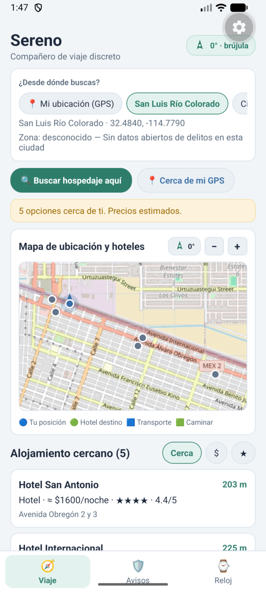 | 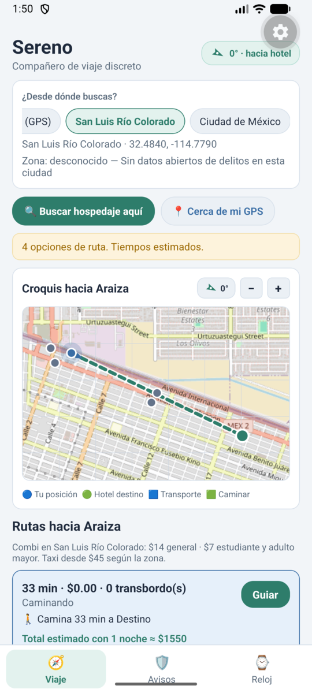 | 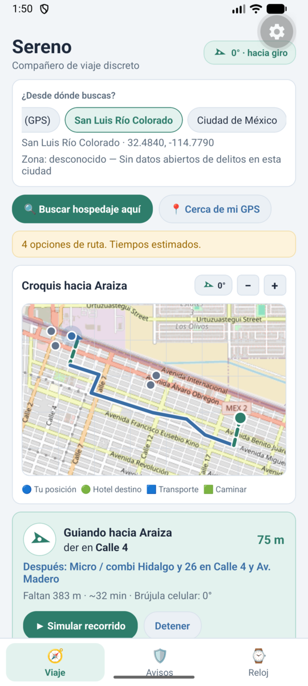 |

| Aviso de zona (CDMX, FGJ) | Aviso de parada para bajar | Pestaña de avisos y vibración |
|---|---|---|
| 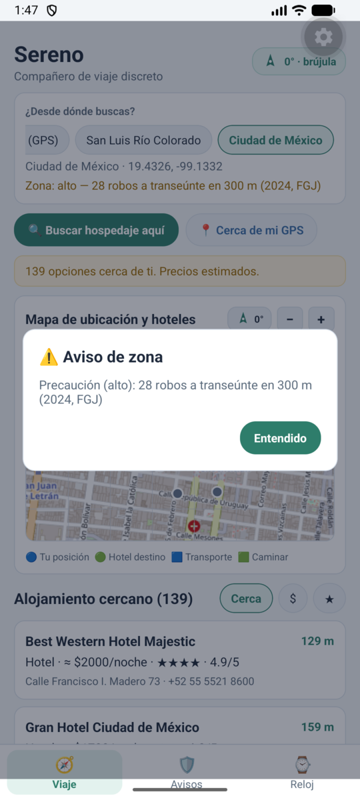 | 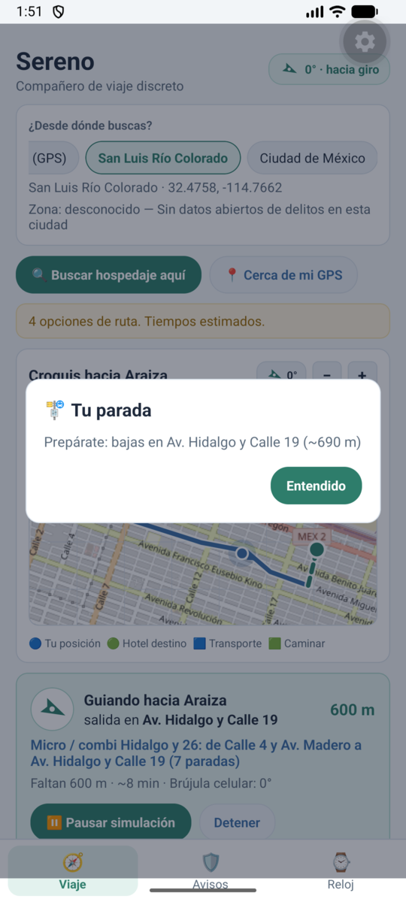 | 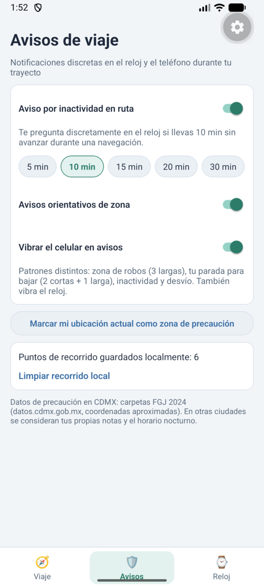 |

### Reloj (Wear OS)

| Inicio | Hoteles por precio | Rutas | Navegación |
|---|---|---|---|
| 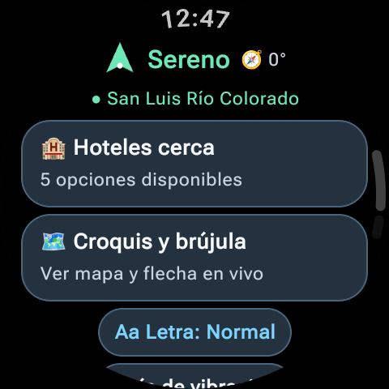 | 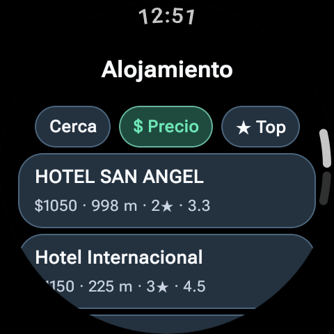 | 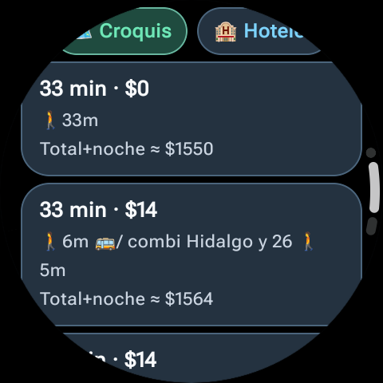 | 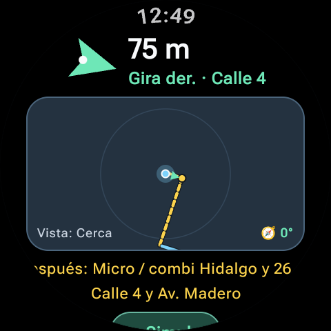 |

| Croquis con brújula | Aviso "Tu parada" | Letra muy grande |
|---|---|---|
| 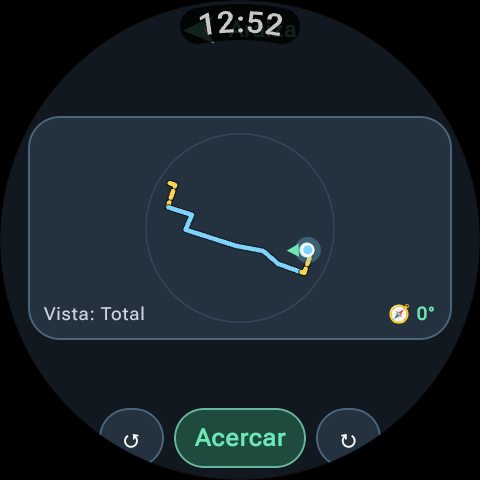 | 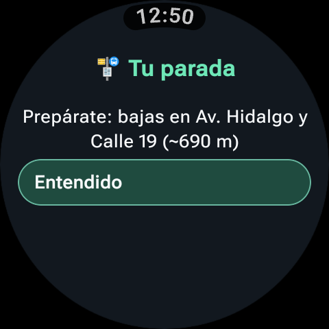 | 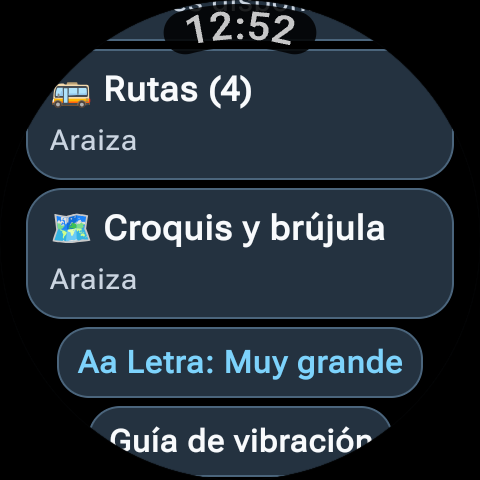 |

---

## Arquitectura del proyecto

```text
mobile/  (teléfono en Expo React Native + TypeScript — Android / iOS / Web)
  App.tsx                 Interfaz principal con mapa OpenStreetMap + SVG y pestañas Viaje / Avisos / Reloj
  puente.js               Puente local en Node.js: HTTP 19888 (Expo Go) <-> TCP 19886/19887 (Emulador Wear OS)
  src/core/Modelos.ts     Modelos y serialización JSON compatible con el reloj (EstadoReloj, Comando, Ruta, Hotel)
  src/core/Geo.ts         Haversine, rumbo, distancia a polilínea, codificación/decodificación y simplificación
  src/datos/Ciudades.ts   Configuración, tarifas y zonas de precio de San Luis Río Colorado y Ciudad de México
  src/datos/Precios.ts    Estimación determinista de precio, estrellas y calificación de cada alojamiento
  src/datos/Osm.ts        Overpass, Nominatim, snapshots locales y rutas locales (rutas_locales_slrc.json)
  src/datos/Ruteo.ts      Rutas a pie giro por giro con OSRM (routing.openstreetmap.de)
  src/datos/Transporte.ts Planificador de transporte público (viajes directos y con 1 transbordo + trazo en mapa)
  src/datos/Riesgo.ts     Evaluación de riesgo (FGJ CDMX por alcaldía + reportes locales)
  src/logica/Interprete.ts Intérprete por reglas de peticiones como "hotel barato cerca" (lo usa el reloj)
  src/logica/EnlaceExpo.ts Cliente HTTP hacia puente.js: estado completo + canal rápido de brújula (/rumbo)
  src/logica/Teselas.ts   Descarga y caché local de teselas OSM con User-Agent propio
  src/logica/Motor.ts     Orquestador principal, GPS/brújula (expo-location), simulador de caminata y alertas
  src/logica/Seguridad.ts Preferencias de avisos (inactividad, zona, vibración) e historial local
  assets/datos/           Copias locales OSM (hoteles_*.json, lineas_*.json) y rutas_locales_*.json
  test/logica.test.ts     Pruebas unitarias de intérprete, ruteo, snapshots OSM, transporte y precios

core/    (librería Kotlin de protocolo y geometría para el reloj)
  Modelos.kt        Hotel, Ruta, Tramo, TrazoMapa, MapaReloj, NavActual, Alerta, EstadoReloj, Comando
  Geo.kt            Haversine, rumbo, distancia a polilínea y codificación de polilíneas
  Enlace.kt         Wearable Data Layer (/sereno/estado y /sereno/cmd) + puente TCP (19886/19887) y brújula en vivo
  EnlaceServicio.kt WearableListenerService

wear/    (reloj Wear OS: interfaz ligera en la muñeca y guía háptica)
  MainActivity.kt   Inicio, Hoteles (Cerca/$/★), Rutas, Croquis con brújula, Navegación, Alertas y tamaño de letra
  RelojApp.kt       Patrones de vibración por giro, zona de riesgo, parada para bajar y avisos
```

---

## Cómo compilar y ejecutar (Reloj en emulador + Celular en Expo)

Consulta el detalle completo en [`EMULADORES.md`](EMULADORES.md).

1. **Compilar y correr pruebas del reloj (`core` + `wear`) y de la app móvil (`mobile`)**:
   ```bash
   JBR=$(ls -d /var/lib/flatpak/app/com.google.AndroidStudio/x86_64/stable/*/files/extra/jbr | head -1)
   ./gradlew -Dorg.gradle.java.home=$JBR test assembleDebug
   npm --prefix mobile test
   ```

2. **Levantar únicamente el emulador del reloj Wear OS en la laptop**:
   ```bash
   cd mobile && npm run reloj
   ```
   *(Este script abre el emulador `Wear_OS_XL_Round`, instala `wear-debug.apk`, configura `adb forward tcp:19887 tcp:19887` y abre la app del reloj automáticamente).*

3. **Iniciar el puente local y abrir la app móvil en Expo Go (Android o iOS)**:
   ```bash
   # Terminal 1: puente local entre Expo (HTTP 19888) y el emulador del reloj (TCP 19886/19887)
   cd mobile && npm run puente

   # Terminal 2: servidor de Expo (escanear el QR con Expo Go en Android o iOS)
   cd mobile && npm start
   ```

---

## Créditos de datos abiertos
- **Mapa y alojamiento**: © Colaboradores de [OpenStreetMap](https://www.openstreetmap.org/copyright) (licencia ODbL).
- **Ruteo peatonal**: OSRM de [FOSSGIS](https://routing.openstreetmap.de/).
- **Incidencia delictiva CDMX**: Portal de Datos Abiertos de la Ciudad de México ([FGJ CDMX](https://datos.cdmx.gob.mx/)).
