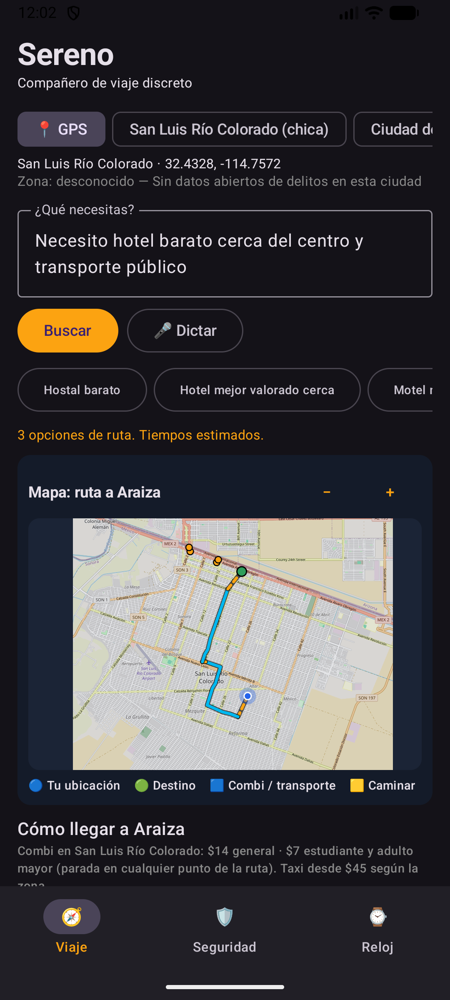
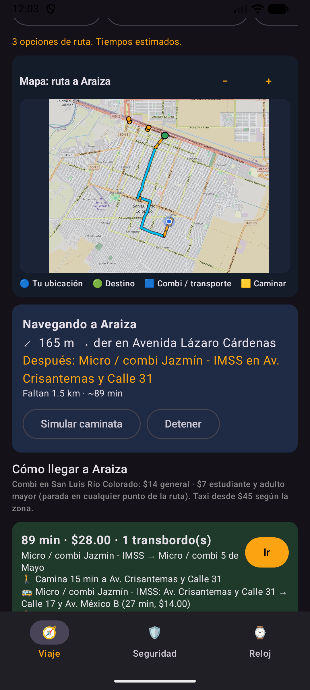
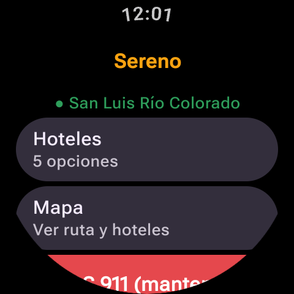
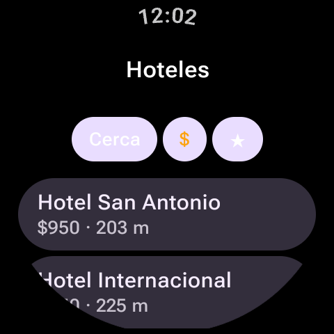
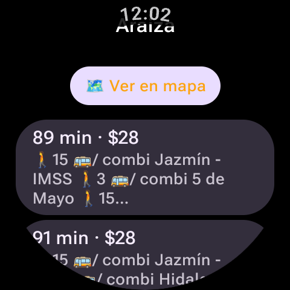
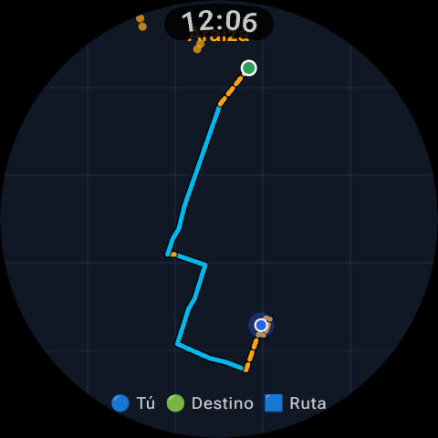
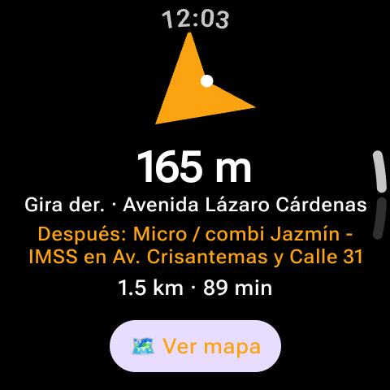
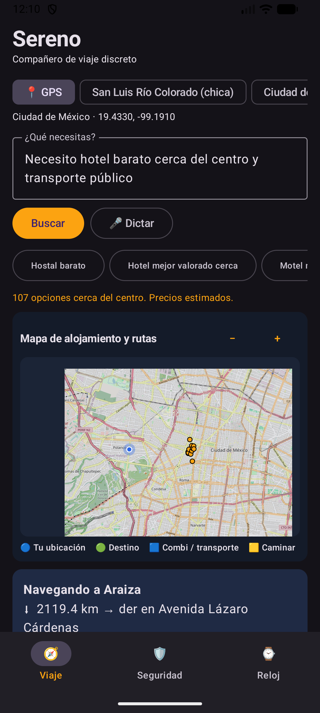
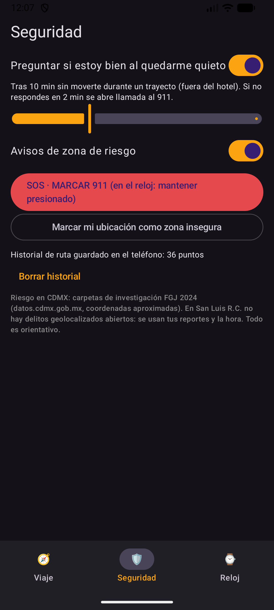

# Sereno — Compañero de viaje discreto (Android + Wear OS)

Aplicación para **smartphone (Android)** y **reloj inteligente (Wear OS)** diseñada para orientar al viajero de manera discreta sin tener que sacar el teléfono en la calle: búsqueda de alojamiento cercano por voz o texto, planeación de transporte público y costos, mapa de ruta tanto en el teléfono como en el reloj, navegación giro por giro mediante patrones de vibración en la muñeca y funciones de seguridad (avisos de zona de riesgo, detección de inactividad y botón SOS 911).

Funciona **100 % con datos abiertos y servicios gratuitos** (OpenStreetMap, OSRM FOSSGIS y Portal de Datos Abiertos de la CDMX).

---

## Ciudades soportadas

| Ciudad | Alojamiento | Transporte público | Tarifas | Taxis | Seguridad |
|---|---|---|---|---|---|
| **San Luis Río Colorado, Son.** *(Chica)* | OpenStreetMap (copia local + Overpass) | **4 rutas públicas de combi** georreferenciadas (`5 de Mayo`, `Av. Sonora - Parque Industrial`, `Hidalgo y Calle 26`, `Jazmín - IMSS I y II`), con ascenso/descenso en cualquier punto del recorrido | **$14 MXN** general · **$7 MXN** estudiante y adulto mayor | **Por zona / cuadro** desde **$45 MXN** hacia arriba | Reportes propios + horario |
| **Ciudad de México** *(Grande)* | OpenStreetMap (copia local + Overpass) | Metro, Metrobús, Trolebús, Tren Ligero, Cablebús, Suburbano y camiones (OSM) | Metro $5, Metrobús $6, Trolebús $4, Tren Ligero $3, Cablebús $7, RTP $2, Micro $7.50 | Banderazo $35 + $9/km | Carpetas FGJ (robos a transeúnte en 300 m) + reportes propios |

---

## Capturas de pantalla (Emulación local Android + Wear OS)

### San Luis Río Colorado — Mapa, rutas de combi y navegación

| Mapa y ruta en el teléfono | Detalle de ruta y navegación |
|---|---|
|  |  |

| Reloj: Inicio | Reloj: Hoteles | Reloj: Rutas de combi | Reloj: Mapa de ruta | Reloj: Navegación por giro |
|---|---|---|---|---|
|  |  |  |  |  |

### Ciudad de México y pestaña de Seguridad

| Ciudad de México (Metro / Metrobús + Mapa) | Pestaña de Seguridad (SOS 911, quietud y riesgo) |
|---|---|
|  |  |

---

## Arquitectura del proyecto

```text
core/    (librería compartida entre teléfono y reloj)
  Modelos.kt        Hotel, Ruta, Tramo, TrazoMapa, MapaReloj, NavActual, Alerta, EstadoReloj, Comando
  Geo.kt            Haversine, rumbo, distancia a polilínea, codificación/decodificación y simplificación
  Enlace.kt         Wearable Data Layer (/sereno/estado y /sereno/cmd) + puente TCP (19886/19887) para emuladores
  EnlaceServicio.kt WearableListenerService

mobile/  (teléfono: realiza las consultas, ruteo, sensores y cálculo)
  datos/Ciudades.kt   Configuración y tarifas de San Luis Río Colorado y Ciudad de México
  datos/Osm.kt        Overpass, Nominatim, snapshots locales y rutas locales (rutas_locales_slrc.json)
  datos/Ruteo.kt      Rutas a pie giro por giro con OSRM (routing.openstreetmap.de)
  datos/Transporte.kt Planificador de transporte público (viajes directos y con 1 transbordo + trazo en mapa)
  datos/Riesgo.kt     Evaluación de riesgo (FGJ CDMX por alcaldía + reportes locales)
  logica/Interprete.kt Intérprete en lenguaje natural por reglas ("hotel barato cerca del centro…")
  logica/Motor.kt     Orquestador principal, GPS, brújula (Sensor.TYPE_ROTATION_VECTOR), simulador y alertas
  logica/Seguridad.kt Marcación rápida al 911, detección de inactividad e historial local CSV
  ui/MainActivity.kt  Interfaz Material 3 con mapa OpenStreetMap integrado y pestañas Viaje / Seguridad / Reloj

wear/    (reloj Wear OS: interfaz ligera en la muñeca y guía háptica)
  MainActivity.kt     Pantallas de Inicio, Hoteles, Rutas, Mapa vectorial circular, Navegación con flecha y Alerta
  RelojApp.kt         Patrones de vibración diferenciados por tipo de giro y alertas
```

---

## Cómo compilar y ejecutar en emuladores locales

1. **Compilar y correr pruebas unitarias**:
   ```bash
   JBR=$(ls -d /var/lib/flatpak/app/com.google.AndroidStudio/x86_64/stable/*/files/extra/jbr | head -1)
   ./gradlew -Dorg.gradle.java.home=$JBR test assembleDebug
   ```

2. **Levantar ambos emuladores (teléfono + reloj) y enlazarlos por puente TCP**:
   Consulta los comandos paso a paso en [`EMULADORES.md`](EMULADORES.md):
   ```bash
   E=~/Android/Sdk/emulator/emulator; A=~/Android/Sdk/platform-tools/adb
   $E -avd Medium_Phone_API_37.0 -gpu swangle_indirect &
   $E -avd Wear_OS_XL_Round      -gpu swangle_indirect &

   P=emulator-5554; W=emulator-5556
   $A -s $P install -r -g mobile/build/outputs/apk/debug/mobile-debug.apk
   $A -s $W install -r -g wear/build/outputs/apk/debug/wear-debug.apk
   $A -s $P shell pm grant com.ralenday.sereno android.permission.ACCESS_LOCAL_NETWORK
   $A -s $W shell pm grant com.ralenday.sereno android.permission.ACCESS_LOCAL_NETWORK
   $A -s $P forward tcp:19886 tcp:19886
   $A -s $W forward tcp:19887 tcp:19887

   $A -s $P shell am start -n com.ralenday.sereno/com.ralenday.sereno.mobile.ui.MainActivity
   $A -s $W shell am start -n com.ralenday.sereno/com.ralenday.sereno.wear.MainActivity
   ```

---

## Créditos de datos abiertos
- **Mapa y alojamiento**: © Colaboradores de [OpenStreetMap](https://www.openstreetmap.org/copyright) (licencia ODbL).
- **Ruteo peatonal**: OSRM de [FOSSGIS](https://routing.openstreetmap.de/).
- **Incidencia delictiva CDMX**: Portal de Datos Abiertos de la Ciudad de México ([FGJ CDMX](https://datos.cdmx.gob.mx/)).
